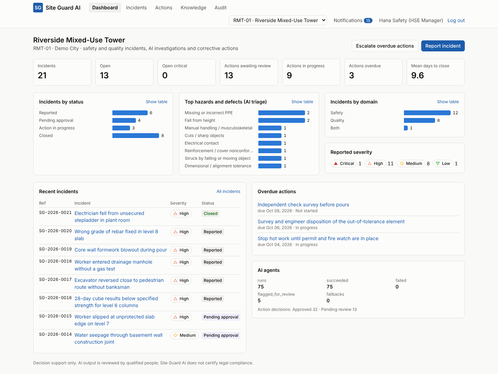
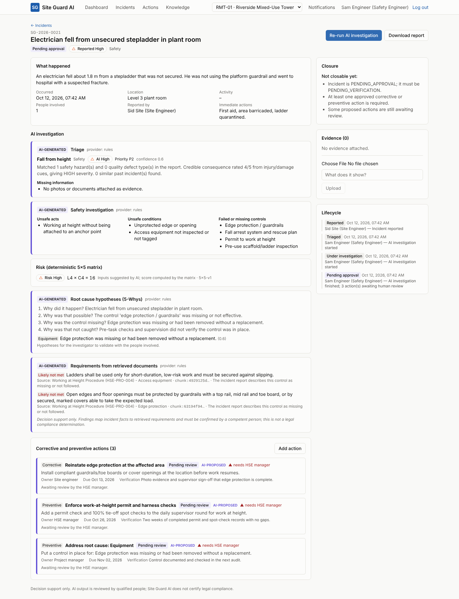
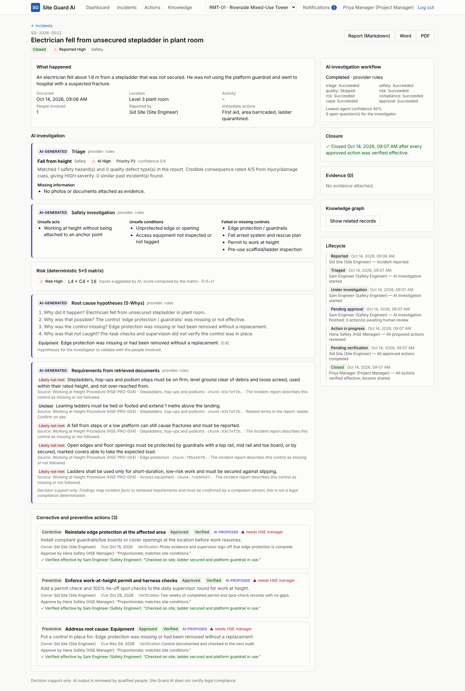

# Site Guard AI: Multi-Agent Construction Safety & Quality Incident Resolution System

**Product:** an Agentic AI-powered Construction Safety & Quality Decision-Support and Workflow Platform.

Site Guard AI helps construction teams investigate safety incidents and quality non-conformances, understand risk,
retrieve the procedures that apply, propose corrective and preventive actions (CAPA), and drive each incident to
verified closure. AI agents do the first pass; qualified people approve every action and close every incident.

> Status: **0.2.0 pilot.** Web app, API, six bounded agents, human approval workflow, escalation, reports,
> evaluation and red-team suite, migrations, Docker and CI are working. Hardening, Azure Bicep with a manual OIDC
> deploy workflow, a staging stack and backup/restore tooling are in place ([DEPLOYMENT](docs/DEPLOYMENT.md)); no
> Azure environment has been created yet. Ported from PR #2: PDF/DOCX knowledge documents, hybrid retrieval (BM25 +
> vectors), grounded answers with citations, Word/PDF reports, an email outbox and photo analysis with engineer
> review, an optional knowledge graph with provenance, resumable workflows with recorded conflicts; each with its
> web screen ([ROADMAP](docs/ROADMAP.md)).



## What it does

```mermaid
flowchart LR
    A[Report incident + evidence] --> B[Triage agent]
    B --> C[Safety / Quality investigation agents]
    C --> D[Deterministic 5x5 risk]
    D --> E[RCA agent - 5 Whys]
    E --> F[Compliance agent - cited requirements]
    F --> G[CAPA agent - proposed actions]
    G --> H{{Human review}}
    H --> I[Track + escalate overdue] --> J[Independent verification] --> K[Closure + report + audit]
```



- **Six bounded agents** with declared tools, budgets, typed outputs, evidence citations and a full trace
  ([docs/AGENTS.md](docs/AGENTS.md)). Covers 11 safety hazard classes (falls, struck-by, excavation, electrical,
  lifting, plant, fire/hot work, PPE, confined space, cuts, manual handling) and 9 quality defect classes
  (honeycombing, cracking, reinforcement/cover, concrete strength, formwork, dimensional, waterproofing,
  welding/steelwork, materials).
- **Runs offline by default** with deterministic rules; set `SITEGUARD_AI_PROVIDER=anthropic` to use Claude, with
  automatic fallback to rules if the model call fails.
- **Human in control:** AI output is never an approved action. Critical actions need the HSE manager, the person who
  did the work cannot verify it, and an incident cannot close until every approved action is verified effective
  and every disagreement the AI found (severity, risk, sources, photos) has a recorded human decision.
- **Workflow:** action queue, notifications with an email outbox (off by default; retries and dead letters), two-level
  escalation of overdue actions, investigation report per incident in Markdown, Word or PDF with AI sections
  labelled and every human decision named.
- **Knowledge base:** upload procedures, ITPs and specifications as PDF, DOCX or Markdown (parsed in an isolated,
  resource-limited process, with page and section provenance); hybrid search (BM25 + vectors, pgvector in
  PostgreSQL); `POST /knowledge/answer` returns cited answers, or says plainly that the evidence is insufficient or
  conflicting.
- **Enterprise basics:** nine roles with server-side RBAC, tenant isolation, evidence validation and SHA-256
  provenance, audit trail with correlation IDs, Alembic migrations, consistent error envelope.

## Real results

All numbers below were produced by the running product (Docker: PostgreSQL + API + web app), not typed by hand.
The incidents and procedures are **synthetic** and labelled as such; see [Data](#data-and-datasets) for why.

**Every incident resolved** ([docs/RESULTS.md](docs/RESULTS.md), one report per incident in
[docs/reports/](docs/reports/)): a project with 20 incidents (11 safety, 8 quality, 1 both) had 13 open. The agents
investigated the ones still at REPORTED and a person reviewed every proposal (65 decisions on record across the
project: 51 approved, 14 rejected with a reason). The escalation job flagged 3 overdue actions (one at management
level, 8 days late), one quality action failed verification and was reworked, and all 21 incidents (including one
reported during the run) ended CLOSED, with 106 agent runs and 0 failures.

**Agent quality** ([docs/EVALUATION.md](docs/EVALUATION.md)) on a labelled held-out set of 24 cases that was never
used for tuning:

| Held-out metric | Before tuning | Now | Target |
|---|---|---|---|
| Hazard/defect class (top-1) | 67% | 79% | 85% (not yet met) |
| Domain (safety / quality / both) | 79% | 83% | 90% (not yet met) |
| Severity within one level | 78% | 91% | 90% |
| CRITICAL cases rated LOW or MEDIUM | 2 | 0 | 0 |
| Expected procedure in top-3 retrieved | 96% | 96% | 85% |
| Red-team attacks contained (10 cases) | | 100% | 100% |

The red-team suite covers prompt injection in reports and documents, fabricated citations, model timeouts and
out-of-schema output, a fatal incident reported as LOW, cross-tenant retrieval and undeclared tool calls. One
paraphrased injection is **not detected** by the pattern guard and is still contained by the workflow (RT02).

| Incident workspace (AI output marked, critical actions routed to the HSE manager) | Closed after verification |
|---|---|
|  |  |

More screens: [incident list](docs/screenshots/04-incident-list.png),
[action queue](docs/screenshots/05-action-queue.png), [knowledge search](docs/screenshots/06-knowledge-search.png),
[grounded answer](docs/screenshots/07-grounded-answer.png), [photo review and workflow](docs/screenshots/08-photo-review-and-workflow.png),
[email outbox](docs/screenshots/09-email-outbox.png).

## Quick start

```bash
git clone https://github.com/sricharansk/SITEGUARD-AI.git
cd SITEGUARD-AI

# Option A: Python + Node, SQLite
make install
make test            # 249 backend tests (incl. evaluation and red-team gates)
make run             # web app http://localhost:8000/app/  ·  API docs http://localhost:8000/docs

# Option B: PostgreSQL + API + web app in Docker
cp .env.example .env # then edit the CHANGE values
make up
make e2e             # browser tests
make demo            # resolve every open incident; regenerates docs/RESULTS.md and docs/reports/
make eval            # regenerates docs/EVALUATION.md
```

Demo logins (password `siteguard-demo`, change with `SITEGUARD_DEMO_PASSWORD`):
`hse@`, `pm@`, `safety@`, `qa@`, `site@`, `auditor@`, `admin@demo.siteguard.local`.
A second tenant, `other@demo.siteguard.local`, proves isolation.

## Repository layout

```text
frontend/        Next.js + TypeScript + Tailwind web app (static export served by the API at /app), Playwright tests
backend/app/
  agents/        framework (allowlist, budget, fallback), registry, rules, Claude provider, orchestrator
  api/           FastAPI routes
  services/      risk, lifecycle, CAPA/approval/verification, notifications/escalation, reports, document parsing,
                 embeddings, hybrid retrieval, grounded answers, evidence, audit
  datasets/      public dataset pipelines (OSHA Severe Injury Reports)
  evaluation.py  gold-set evaluation and red-team suite
  jobs.py        scheduled jobs (escalate overdue actions)
backend/migrations/  Alembic
backend/tests/   unit, agent, API, notification, migration, dataset and evaluation tests
data/seed/       synthetic incidents, demo users, synthetic procedures and ITPs
data/eval/       labelled synthetic evaluation set (dev + held-out test)
data/dataset_registry.yaml  public datasets with licence and allowed use
docs/            PRD, architecture, agents, API, database, security, testing, datasets, results, evaluation, decisions
docs/planning/   the original implementation blueprint, playbook and strategy documents
scripts/         resolve_all.py (results run), demo_walkthrough.py (single incident)
```

## Tech stack

Python 3.12, FastAPI, Pydantic, SQLAlchemy, Alembic, PostgreSQL (pgvector image), Anthropic SDK; Next.js 16,
React 19, TypeScript, Tailwind 4, Playwright; Docker, GitHub Actions; pgvector hybrid search; optional Neo4j
knowledge graph; Azure Bicep. Planned: a trained vision detection model, Entra ID.

## Data and datasets

- The pilot ships **synthetic** incidents, procedures and evaluation cases so it runs anywhere without licensed or
  confidential data. Real company incident data cannot be published.
- Public sources (OSHA Severe Injury Reports and ITA, BLS CFOI 2024, HSE 2024/25–2025/26, NIOSH FACE, 2024–2026
  construction vision datasets) are registered with licence and allowed use in
  [data/dataset_registry.yaml](data/dataset_registry.yaml) and [docs/DATASETS.md](docs/DATASETS.md). Several vision
  datasets are non-commercial.
- **The OSHA Severe Injury Reports pipeline is built and tested** (`python -m app.datasets.osha_sir`): it scores the
  triage agent on real construction injury narratives against OSHA's own event coding. It has **not** been run on
  the real file yet, because the sandbox used to build 0.2.0 could not reach osha.gov; run the one command in
  DATASETS.md on any machine with internet access to produce the real-data report.

## Safety boundary

Site Guard AI is decision support. It does not certify legal compliance, does not make high-impact safety
decisions on its own, and does not close safety-critical incidents without verified human action.

## Project documents

Start with [CLAUDE.md](CLAUDE.md), then [docs/PRD.md](docs/PRD.md), [docs/ARCHITECTURE.md](docs/ARCHITECTURE.md),
[docs/AGENTS.md](docs/AGENTS.md) and [docs/API.md](docs/API.md). Changes: [docs/CHANGELOG.md](docs/CHANGELOG.md).
The full planning package (implementation blueprint, 51-prompt execution playbook, GitHub strategy, product
positioning) is in [docs/planning/](docs/planning/).
