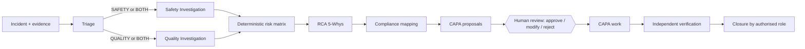

# Agents

Site Guard AI uses six bounded agents inside a fixed workflow. Agents recommend; people decide.
Code: `backend/app/agents/`.

## Workflow

The orchestrator (`orchestrator.py`) runs the steps in order. It moves the incident to `PENDING_APPROVAL` and
stops. No agent can approve an action, change a risk score or close an incident.

## Bounded agent contract

Each agent (`registry.py`) declares:

| Field | Meaning |
|---|---|
| `tools` | Allowlist. Calling any other tool raises `ToolNotAllowed` and is recorded in the trace. |
| `max_tool_calls` | Budget. Exceeding it raises `BudgetExceeded`. |
| `gather` | Calls declared tools to build an *evidence pack* (incident, evidence, retrieved chunks, prior outputs). |
| output schema | Pydantic model in `schemas.py`; anything else is rejected. |
| `rules` | Deterministic decision function used offline and as the fallback. |
| `system_prompt` | Role prompt for the Claude provider. |

| Agent | Tools | Output |
|---|---|---|
| triage | get_incident, list_evidence, search_knowledge, similar_incidents | class, domain, severity, priority, hazards, missing info, next agents |
| safety | + get_prior_outputs | hazards, unsafe acts/conditions, failed controls, suggested likelihood/consequence |
| quality | + get_prior_outputs | defects, requirement vs observed, probable stage, tests, suggested likelihood/consequence |
| rca | + get_prior_outputs | 5-Whys chain, categorised root-cause hypotheses with confidence |
| compliance | + get_prior_outputs | requirements from retrieved documents with chunk citations and LIKELY_MET / LIKELY_NOT_MET / UNCLEAR |
| capa | + get_prior_outputs | corrective and preventive actions with owner role, due days, verification criteria |

Every output carries `confidence`, `evidence_refs` and `open_questions`.

## Providers

- `rules` (default): offline, deterministic, uses an explicit construction hazard/defect taxonomy (`rules.py`).
- `anthropic`: Claude (`SITEGUARD_ANTHROPIC_MODEL`, default `claude-opus-5-5`) reads the evidence pack and returns
  the agent's schema through structured outputs. The model gets no tools and no write access.

If the Claude call fails for any reason (missing key, timeout, refusal, invalid output) the rules provider answers
and the run's provider reads `rules (fallback from anthropic)`. Seeding always uses `rules`.

## Evidence and provenance

- Allowed refs are `incident:<id>`, `evidence:<id>` and `chunk:<id>` from the evidence pack only.
- Any cited ref that was not in the pack is removed, and the run is flagged for human review.
- Each run stores provider, output, a tool-call trace and review reasons in `agent_runs`.

## Untrusted content and prompt injection

Retrieved documents and incident text are data. Incident text and evidence descriptions are also scanned; a match
flags every run for review. Chunks matching instruction-like patterns are marked
`suspicious` at ingestion (title, heading and text are checked); agents never cite them and the run is flagged.
The Claude provider wraps the pack in `<evidence_pack>` tags with an instruction not to follow anything inside it,
and escapes `<` and `>` in the pack so its content cannot close the tag.

## Retrieval

`services/rag.py`, used by the `search_knowledge` tool, `GET /search` and knowledge answers. Documents are parsed
(PDF pages, DOCX headings and tables, Markdown), split into chunks that keep their section heading and PDF page,
and embedded. Access filters (organization, then organization-wide or this project's documents, `READY` only) are
applied in the database query before any scoring. BM25 and vector similarity rank the allowed chunks, reciprocal
rank fusion combines them, and a deterministic reranker (query coverage, heading match, phrase match) orders the
top candidates. The embedder is offline and deterministic (`hashing-bow` v1, Decision 017); a semantic model plugs
in behind the `Embedder` interface. `SITEGUARD_RETRIEVAL_MODE=lexical` uses BM25 only.

## Knowledge answers (`POST /knowledge/answer`)

A bounded RAG answer, separate from the incident workflow (`services/answer.py`):

1. Retrieve up to 6 hits through the hybrid search, scoped to the caller's organization and project (plus
   organization-wide documents). With an `incident_id`, the incident title is added to the query.
2. Drop suspicious (instruction-like) chunks and list them under `excluded_sources`.
3. If no source contains at least a third of the question's terms, return `INSUFFICIENT_EVIDENCE` without calling
   any model.
4. The answerer drafts statements, each citing `chunk:` refs: `rules` extracts the best-matching source sentences;
   `anthropic` uses Claude with the sources wrapped in `<sources>` as untrusted data and the `AnswerDraft` schema.
   A provider failure falls back to `rules` (`provider` reads `rules (fallback from anthropic)`).
5. Every statement must cite a retrieved ref and share at least half of its terms with a cited chunk; anything else
   moves to `unsupported_claims` and is not part of the answer.
6. Statements from different documents that give different values in the same unit for the same requirement are
   reported in `conflicts`; the status becomes `CONFLICTING_EVIDENCE` and confidence is capped at 0.4.

`needs_human_review` is true unless the status is `ANSWERED`, nothing was unsupported and confidence ≥ 0.5. Every
answer carries the decision-support disclaimer and is audited as `knowledge.answer`.

## Risk engine

`services/risk.py`, matrix version `5x5-v1`: score = likelihood x consequence; LOW <= 4, MEDIUM <= 9,
HIGH <= 16, CRITICAL >= 17. Agents only suggest the two inputs. A human can record their own assessment with
`POST /incidents/{id}/risk`; the score still comes from the matrix.

## Human approval

- AI proposals start as `PENDING_REVIEW`. Decisions: `APPROVE`, `MODIFY` (with changes), `REJECT`; a reason is
  required; the original AI output, before/after snapshot and reviewer are stored in `approval_events`.
- Actions on HIGH or CRITICAL risk incidents are `critical` and need `APPROVE_CRITICAL` (HSE manager).
- Re-running the investigation marks unreviewed AI proposals `SUPERSEDED`.
- Only approved or modified actions can be worked. The person who did an action cannot verify it.
- Closure needs: status `PENDING_VERIFICATION`, no actions awaiting review, every approved action verified
  effective, and for CRITICAL incidents the `APPROVE_CRITICAL` permission.

## Failure behaviour

An agent that raises is recorded as `FAILED`; the workflow continues with the remaining agents, the incident is
kept, and people can add actions manually (`POST /incidents/{id}/capa`) and use manual transitions.

## Coverage and evaluation

The rules taxonomy covers 11 safety hazard classes and 9 quality defect classes, each with proposed corrective and
preventive actions. Scores on a labelled held-out set and the red-team results are in [EVALUATION.md](EVALUATION.md);
real-data scoring on OSHA Severe Injury Reports is in `app/datasets/osha_sir.py`.
