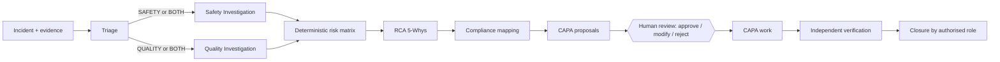

# Agents

Site Guard AI uses six bounded agents inside a fixed workflow. Agents recommend; people decide.
Code: `backend/app/agents/`.

## Workflow

The orchestrator (`orchestrator.py`) runs the steps in order. It moves the incident to `PENDING_APPROVAL` and
stops. No agent can approve an action, change a risk score or close an incident.

### Checkpoints, pause and resume

Each run is a `workflow_runs` row (Decision 024). Stages: `triage`, `safety`, `quality`, `risk`, `rca`,
`compliance`, `capa`, `approval`. After every stage the stage record and its validated output are saved with the
stage's own records in one transaction. Then:

- `?pause_after=<stage>` on `POST /incidents/{id}/investigate`, or `POST /workflows/{id}/pause` while running,
  stops the workflow as `PAUSED` before the next stage so a person can review what is stored.
- `POST /workflows/{id}/resume` continues from the next unfinished stage with the stored state; finished stages
  are never repeated, so agent runs, risk assessments and actions are never duplicated.
- `POST /workflows/{id}/cancel` stops it with a reason; nothing stored is removed.
- A stage that raises an unexpected error is rolled back, recorded as `ERROR`, and the workflow becomes `FAILED`
  (the person who started it is notified); it can be resumed once the cause is fixed.
- A `RUNNING` workflow whose lease (`SITEGUARD_WORKFLOW_LEASE_SECONDS`) has passed is treated as crashed and can be
  resumed.
- Only one workflow per incident may be `RUNNING`, `PAUSED` or `FAILED` (409 `WORKFLOW_ACTIVE`).

## Conflicts and uncertainty

The workflow never picks a winner silently (`services/conflicts.py`). At the approval stage it records an
`agent_conflicts` row, with both sides and references, for each of:

| Kind | When |
|---|---|
| `SEVERITY_DISAGREEMENT` | AI triage severity is two or more levels from the reported severity |
| `DOMAIN_DISAGREEMENT` | Triage classes a SAFETY incident as QUALITY or the reverse |
| `RISK_ABOVE_REPORTED` | The risk matrix band is CRITICAL, or two levels above the reported severity |
| `AGENT_DISAGREEMENT` | Safety and quality investigations differ by two or more on likelihood or consequence (the matrix uses the higher) |
| `SOURCE_CONFLICT` | Two cited documents in scope give different values, in the same unit, for the same requirement |
| `VISION_DISAGREEMENT` | Two analyses of the same photo and task disagree whether a label is present |
| `VISION_REVIEW_DISAGREEMENT` | Reviewers confirmed and rejected the same label on the same photo |

People with `APPROVE_CAPA` are notified (`AI_CONFLICT`). An `OPEN` conflict blocks closure until a person records a
decision (`POST /conflicts/{id}/resolve`); a later investigation marks still-open conflicts `SUPERSEDED` and
records its own. The workflow also stores an uncertainty summary: confidence per agent, the lowest confidence,
low-confidence agents, agents needing review with their reasons, failed stages and every open question.

## Bounded agent contract

Each agent (`registry.py`) declares:

| Field | Meaning |
|---|---|
| `tools` | Allowlist. Calling any other tool raises `ToolNotAllowed` and is recorded in the trace. |
| `max_tool_calls` | Budget. Exceeding it raises `BudgetExceeded`. |
| `gather` | Calls declared tools to build an *evidence pack* (incident, evidence, retrieved chunks, prior outputs). |
| output schema | Pydantic model in `schemas.py`; anything else is rejected. |
| `rules` | Deterministic decision function used offline and as the fallback. |
| `system_prompt` | Role prompt for the Claude provider. |

| Agent | Tools | Output |
|---|---|---|
| triage | get_incident, list_evidence, search_knowledge, similar_incidents | class, domain, severity, priority, hazards, missing info, next agents |
| safety | + get_prior_outputs | hazards, unsafe acts/conditions, failed controls, suggested likelihood/consequence |
| quality | + get_prior_outputs | defects, requirement vs observed, probable stage, tests, suggested likelihood/consequence |
| rca | + get_prior_outputs | 5-Whys chain, categorised root-cause hypotheses with confidence |
| compliance | + get_prior_outputs | requirements from retrieved documents with chunk citations and LIKELY_MET / LIKELY_NOT_MET / UNCLEAR |
| capa | + get_prior_outputs | corrective and preventive actions with owner role, due days, verification criteria |

Every output carries `confidence`, `evidence_refs` and `open_questions`.

## Providers

- `rules` (default): offline, deterministic, uses an explicit construction hazard/defect taxonomy (`rules.py`).
  Triage weighs keyword evidence (title words count double, ambiguous words half), recognises an object falling, a
  person falling and a person being struck, treats a measured deviation ("15 mm out") as a tolerance cue, and ignores
  words that name a place or a reason rather than the hazard: crane access ("guardrail removed for crane access") is
  not a lift, and someone under a scaffold ("no hard hat under the scaffold loading bay") is not working at height. It
  reports BOTH only with real evidence on both sides, never narrows a reported BOTH while both sides have evidence,
  and leaves a report unclassified (for a person to classify) when only one ambiguous word matched. The compliance
  agent cites a requirement only when it shares two words with the report (or one hazard term), and marks it likely
  not met only when the report negates one of them; "worker" does not count as the requirement word "work".
- `anthropic`: Claude (`SITEGUARD_ANTHROPIC_MODEL`, default `claude-opus-5-5`) reads the evidence pack and returns
  the agent's schema through structured outputs. The model gets no tools and no write access.

If the Claude call fails for any reason (missing key, timeout, refusal, invalid output) the rules provider answers
and the run's provider reads `rules (fallback from anthropic)`. Seeding always uses `rules`.

## Evidence and provenance

- Allowed refs are `incident:<id>`, `evidence:<id>` and `chunk:<id>` from the evidence pack only.
- Any cited ref that was not in the pack is removed, and the run is flagged for human review.
- Each run stores provider, output, a tool-call trace and review reasons in `agent_runs`.

## Untrusted content and prompt injection

Retrieved documents and incident text are data. Incident text and evidence descriptions are also scanned; a match
flags every run for review. Chunks matching instruction-like patterns are marked
`suspicious` at ingestion (title, heading and text are checked); agents never cite them and the run is flagged.
The Claude provider wraps the pack in `<evidence_pack>` tags with an instruction not to follow anything inside it,
and escapes `<` and `>` in the pack so its content cannot close the tag.

## Retrieval

`services/rag.py`, used by the `search_knowledge` tool, `GET /search` and knowledge answers. Documents are parsed
(PDF pages, DOCX headings and tables, Markdown), split into chunks that keep their section heading and PDF page,
and embedded. Access filters (organization, then organization-wide or this project's documents, `READY` only) are
applied in the database query before any scoring. BM25 and vector similarity rank the allowed chunks, reciprocal
rank fusion combines them, and a deterministic reranker (query coverage, heading match, phrase match) orders the
top candidates. The embedder is offline and deterministic (`hashing-bow` v1, Decision 017); a semantic model plugs
in behind the `Embedder` interface. `SITEGUARD_RETRIEVAL_MODE=lexical` uses BM25 only.

## Vision

Playbook Prompts 25–27; code in `services/vision.py` (pipeline, taxonomy, thresholds), `services/vision_worker.py`
(image decoding) and `agents/vision.py` (analyzers); DECISIONS 022.

1. **Integrity.** The stored file is hashed and compared with the evidence's recorded SHA-256. A mismatch is refused
   (409 `EVIDENCE_INTEGRITY`) and audited as `evidence.integrity_failed`.
2. **Preprocessing** in a child process with CPU, memory and time limits (`SITEGUARD_VISION_*`): only JPEG and PNG,
   the decoded format must match the evidence type, images above `SITEGUARD_VISION_MAX_PIXELS` are refused
   (decompression bombs), EXIF orientation is applied, and the image is re-encoded as JPEG without EXIF/GPS metadata
   and scaled to at most `SITEGUARD_VISION_MAX_SIDE` pixels. The original evidence file is never changed.
3. **Image-quality checks** (deterministic): `LOW_RESOLUTION` (short side < 480 px), `TOO_DARK`, `OVEREXPOSED`,
   `LOW_CONTRAST` and `POSSIBLY_BLURRED`. Flags become limitations on the analysis, not detections.
4. **Analyzer** (`SITEGUARD_VISION_PROVIDER`) with the labels for the task:
   - `baseline` (default): no detection model; reports nothing, so the analysis says that no PPE, hazard or defect
     detection was attempted. The detection model is an open owner decision: the public PPE and defect datasets are
     licensed for research and evaluation only (`docs/DATASETS.md`).
   - `anthropic`: Claude vision with the `VisionDraft` schema; self-reported confidence and approximate boxes, both
     stated in the limitations. Text in the image is treated as untrusted content.
   An analyzer failure is stored as `FAILED` with no observations; it never falls back to a result that would look
   like "nothing found".
5. **Taxonomy and thresholds.** Taxonomy `2026.10-1` (`GET /vision/taxonomy`): PPE labels (person without hard hat,
   hi-vis, harness at height, eye protection), hazard labels (unprotected edge, uncovered opening, unsupported
   excavation, suspended load over people, unsafe ladder, exposed electrical, hot work without controls, unsecured
   materials at height, blocked route) and defect labels (crack, spalling, honeycombing, exposed reinforcement,
   corrosion, moisture staining, efflorescence). Each maps to a hazard or defect in the agents' taxonomy where one
   exists. Detections with other labels are discarded and counted; boxes outside the image are dropped. The
   threshold is 0.5 unless a project or site calibration sets another (site beats project beats default); the
   snapshot of thresholds and their source is stored with the analysis. Below-threshold observations are kept and
   marked, so a later calibration can be checked against them.
6. **Human validation.** People with `RUN_AGENTS` confirm or reject each observation with a note (not on a
   closed incident). Agents get observations from completed analyses through `list_vision_observations`, without
   the analyzer's free text, in two lists: `vision` holds the observations a person CONFIRMED (also below threshold),
   the only ones with a citable `vision:<id>` ref; `vision_unreviewed` holds above-threshold observations nobody has
   checked, with no ref. A model citing anything else has the citation removed and the run flagged, like any unknown
   ref. The rules provider adds the mapped hazard or defect for confirmed observations and turns unreviewed ones into
   open questions. Quality detections therefore count as findings only after engineer validation.
7. **Limits.** Each user may start `SITEGUARD_VISION_RATE_LIMIT_PER_MINUTE` analyses a minute (429 `RATE_LIMITED`),
   and at most four decoder or parser child processes run at once per API process.

Every response carries the disclaimer that observations are machine output for human review, not proof, and that no
observation does not mean no hazard or defect.

## Knowledge answers (`POST /knowledge/answer`)

A bounded RAG answer, separate from the incident workflow (`services/answer.py`):

1. Retrieve up to 6 hits through the hybrid search, scoped to the caller's organization and project (plus
   organization-wide documents). With an `incident_id`, the incident title is added to the query.
2. Drop suspicious (instruction-like) chunks and list them under `excluded_sources`.
3. If no source contains at least a third of the question's terms, return `INSUFFICIENT_EVIDENCE` without calling
   any model.
4. The answerer drafts statements, each citing `chunk:` refs: `rules` extracts the best-matching source sentences;
   `anthropic` uses Claude with the sources wrapped in `<sources>` as untrusted data and the `AnswerDraft` schema.
   A provider failure falls back to `rules` (`provider` reads `rules (fallback from anthropic)`).
5. Every statement must cite a retrieved ref and share at least half of its terms with a cited chunk; anything else
   moves to `unsupported_claims` and is not part of the answer.
6. Statements from different documents that give different values in the same unit for the same requirement are
   reported in `conflicts`; the status becomes `CONFLICTING_EVIDENCE` and confidence is capped at 0.4.

`needs_human_review` is true unless the status is `ANSWERED`, nothing was unsupported and confidence ≥ 0.5. Every
answer carries the decision-support disclaimer and is audited as `knowledge.answer`.

## Risk engine

`services/risk.py`, matrix version `5x5-v1`: score = likelihood x consequence; LOW <= 4, MEDIUM <= 9,
HIGH <= 16, CRITICAL >= 17. Agents only suggest the two inputs. A human can record their own assessment with
`POST /incidents/{id}/risk`; the score still comes from the matrix.

## Human approval

- AI proposals start as `PENDING_REVIEW`. Decisions: `APPROVE`, `MODIFY` (with changes), `REJECT`; a reason is
  required; the original AI output, before/after snapshot and reviewer are stored in `approval_events`.
- Actions on HIGH or CRITICAL risk incidents are `critical` and need `APPROVE_CRITICAL` (HSE manager).
- Re-running the investigation marks unreviewed AI proposals `SUPERSEDED`.
- Only approved or modified actions can be worked. The person who did an action cannot verify it.
- Closure needs: status `PENDING_VERIFICATION`, no actions awaiting review, every approved action verified
  effective, and for CRITICAL incidents the `APPROVE_CRITICAL` permission.

## Failure behaviour

An agent stage is tried up to `SITEGUARD_AGENT_MAX_ATTEMPTS` times with exponential backoff
(`SITEGUARD_AGENT_RETRY_BACKOFF_SECONDS`). A stage that still fails is recorded as `FAILED` with its attempts; the
workflow continues with the remaining agents, the incident is kept, and people can add actions manually
(`POST /incidents/{id}/capa`) and use manual transitions. An error outside an agent (for example while storing
actions) rolls the stage back and fails the workflow, which can then be resumed (see "Checkpoints, pause and
resume").

## Coverage and evaluation

The rules taxonomy covers 11 safety hazard classes and 9 quality defect classes, each with proposed corrective and
preventive actions. Scores on a labelled held-out set and the red-team results are in [EVALUATION.md](EVALUATION.md);
real-data scoring on OSHA Severe Injury Reports is in `app/datasets/osha_sir.py`.
