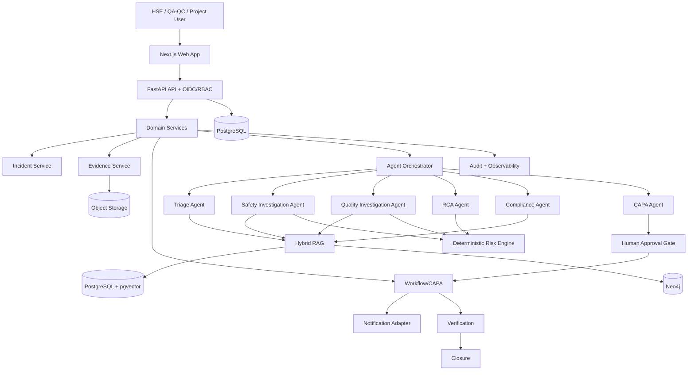

# Architecture

Source: Blueprint Part 6. The diagram below is the **target** architecture; the table after it says what is
implemented today.

## Pattern

Modular backend + responsive web app + bounded agent orchestration. Every component is deployable in containers.

## Target stack

| Layer | Target |
|---|---|
| Frontend | Next.js, React, TypeScript, Tailwind CSS |
| Backend | Python, FastAPI, Pydantic, SQLAlchemy, Alembic |
| Data | PostgreSQL, pgvector, object storage, Neo4j |
| AI | Provider abstraction for an approved enterprise LLM/VLM; Transformers/PyTorch where custom models are needed; vision adapters; stateful orchestration |
| Search / RAG | Hybrid lexical + vector search, reranking, metadata/authorization filtering, source citations |
| Workflow | Transactional application state machine for the MVP; Temporal/Camunda only if durable distributed workflows are justified later |
| DevOps | Docker, GitHub Actions, Azure Container Registry, Azure Container Apps (pilot), Azure Database for PostgreSQL, Azure Blob Storage, Azure Key Vault, Azure Monitor / Application Insights |



## Implemented today vs target

| Component | Today | Target / gap |
|---|---|---|
| Web app | Next.js 16 app in `frontend/`: same-origin BFF with an httpOnly session cookie (DECISIONS 018); dashboard, incident command center, CAPA review board, knowledge search, audit log | SSO sign-in (O1) |
| API | FastAPI, typed schemas, error envelope, correlation IDs | Same |
| Authentication | Email + password, HS256 JWT, login rate limit | OIDC / Microsoft Entra ID |
| Authorization | Server-side RBAC, 9 roles, organization/project scoping | Same |
| Database | PostgreSQL 16 with pgvector, or SQLite; Alembic migrations; chunk embeddings stored | Same; HNSW index once a semantic model is chosen |
| Evidence storage | Local disk under random keys, SHA-256 recorded | Azure Blob Storage adapter |
| Documents | PDF (pypdf), DOCX (python-docx), Markdown and text parsers; heading/page/semantic chunking with page and section provenance; original file kept | OCR for scanned PDFs |
| Retrieval | Hybrid: access-filtered candidates, BM25 + vector (offline hashing embedder), reciprocal rank fusion, deterministic reranker; grounded answers with citations, insufficient/conflicting-evidence statuses | Semantic embedding model and cross-encoder reranker behind the same interfaces (DECISIONS O5) |
| Knowledge graph | Optional Neo4j projection of PostgreSQL (`services/graph.py`), rebuilt per organization by `python -m app.jobs graph-sync` or `POST /graph/sync`; incident neighbourhood with provenance at `GET /incidents/{id}/graph`; off by default (see [Knowledge graph](#knowledge-graph)) | Graph-aware retrieval for agents (the RAG → KG edge in the diagram) and cross-incident analytics |
| Orchestration | Bounded sequential workflow per run (DECISIONS 007); runs and traces stored | Stateful orchestration with checkpoints if needed |
| AI providers | Rules (default, offline) and Claude behind one `Provider` interface, with fallback | Same abstraction; VLM adapters for vision |
| Risk | Deterministic 5x5 matrix, versioned | Same |
| Workflow | Transactional incident and CAPA state machines | Same; reminders and escalation (Prompt 24) |
| Reports | Incident report (Markdown, Word, PDF) rendered by `services/reports.py` from stored records only, AI sections labelled, generation audited | Project summary reports |
| Notifications | In-app notifications from workflow events (via the audit trail), escalation rules for overdue actions, unreviewed severe incidents and waiting critical reviews, email outbox with retries and dead letters (`python -m app.jobs`); external delivery off by default | Teams/SMS channels (O7) |
| Vision | None | PPE/hazard and defect detection (Prompts 25–27) |
| Observability | JSON logs, correlation IDs, audit events, agent traces | Metrics, OpenTelemetry, App Insights |
| Deployment | Docker image, Compose, GitHub Actions | Azure (Prompts 45–46) |

## Agent components

Triage; Safety Investigation; Quality Investigation; RCA; Compliance; CAPA. Responsibilities, tools, budgets,
schemas and failure behaviour are in `docs/AGENTS.md`.

Every agent specifies: allowed tools; input (evidence pack) and output schema; evidence requirements; uncertainty
fields; maximum execution budget; failure behaviour; human-review conditions.

## Retrieval pipeline

```text
upload ─ parse (pdf | docx | text) ─ chunk (heading | page | semantic) ─ flag injection ─ embed ─ READY
query ─ access filter (organization, project or org-wide, READY, domain) ─┬─ BM25 ─────┐
                                                                         └─ vector ───┴─ RRF (k=60) ─ rerank ─ hits
answer ─ hits minus suspicious ─ answerer (rules or Claude) ─ citation + support check ─ conflict check ─ status
```

Every retrieval path starts from the access filter (`rag._allowed`), so a project document can never reach a
query in another project. Final score = 0.5 × normalised fused score + 0.5 × rerank score (query-term coverage,
heading match, phrase match). A hit carries document, version, effective date, page, section, tags, scope and the
individual scores, which is what citations show.

## Knowledge graph

PostgreSQL stays the system of record (DECISIONS 002). The graph is a derived projection: `build_projection` reads one
organization's records, and the store makes that organization's part of the graph equal to the result. Nothing is
written back to PostgreSQL and no model is called; every value is copied from a stored row.

```text
graph-sync (job or POST /graph/sync) ─ per organization: read PostgreSQL ─ projection (nodes + relationships)
  ─ store: MERGE every node on (label, id) and every relationship on its id ─ delete what the projection no longer has
GET /incidents/{id}/graph ─ authorize like reading the incident ─ incident-owned nodes + their direct neighbours
  ─ organization and caller's projects only ─ nodes and edges with provenance
```

`SITEGUARD_GRAPH_BACKEND` selects the store: `disabled` (default), `memory` (inside the API process, for tests and
single-process demos; a separate job process has its own copy) or `neo4j` (official driver; `docker compose
--profile graph up -d neo4j` starts one locally). Re-running a sync changes nothing. A record deleted in PostgreSQL
disappears from the graph, with its relationships, on the next sync of its organization; `graph-sync` also removes
organizations that no longer exist. Between syncs the graph can be behind PostgreSQL.

### Provenance

Every node and relationship carries `organization_id`, `project_id` (null for organization-level records) and:

| Field | Meaning |
|---|---|
| `source_table`, `source_id` | The PostgreSQL row it came from |
| `source_field` | The column or JSON path, when it came from one field (`location`, `output.hazards[2]`, `output.findings[0].source_ref`) |
| `ai_derived` | True when the content was taken from AI output (`agent_runs.output`, or an action the CAPA agent proposed) |
| `agent_run_id` | The `agent_runs` row for AI-derived items |
| `review_status` | `UNREVIEWED` for AI output no person has reviewed (hazards, causes, requirements, investigations); for actions `UNREVIEWED`, `HUMAN_APPROVED`, `HUMAN_MODIFIED`, `HUMAN_REJECTED` or `SUPERSEDED` from `capa_actions.approval_status` |

Nodes owned by an incident also carry `incident_id`. Relationship ids are deterministic
(`TYPE:start->end`, plus the source record id or cited ref where two records can link the same pair).

### Nodes

| Label | One node per | Notes |
|---|---|---|
| Organization | `organizations` row | |
| Project | `projects` row | |
| Site | `sites` row | |
| Location | incident with a `location` value | Asset/Location: there is no asset or location register, so this is the incident's free-text `location` (id `<incident>:location`, normalised `key` for grouping). Equipment named only in text is not extracted |
| Person | user named by the organization's records or memberships | Person/Role: id `<organization>:<user>`, so a user in two organizations is two nodes; roles are on `MEMBER_OF`; only the full name and active flag are copied (no email) |
| Incident | `incidents` row | Reference, title, status, severity, domain, dates, `is_synthetic` |
| Evidence | `evidence` row | File name, type, size, SHA-256 (no storage key) |
| Document | `documents` row | Title, type, version, status, domain, effective date, tags, SHA-256 |
| Investigation | `agent_runs` row of the triage, safety or quality agent | Run status and provider plus the output's scalar and list fields |
| Hazard | distinct hazard in a triage or safety output (`output.hazards[i]`) | Per run, so each keeps its exact source; group across incidents by `key` |
| RCA | `agent_runs` row of the RCA agent | Problem statement, whys, contributing factors |
| Cause | root cause in an RCA output (`output.root_causes[i]`) | Category, statement, confidence |
| Requirement | finding in a compliance output (`output.findings[i]`) | `status` is LIKELY_MET / LIKELY_NOT_MET / UNCLEAR: a possible gap for review, never a compliance determination |
| Action | `capa_actions` row | Type, owner role, due date, critical, approval and work status |

### Relationships

| Type | From → to | Source |
|---|---|---|
| BELONGS_TO | Project → Organization; Document → Organization (organization-wide documents) | `projects.organization_id`, `documents.organization_id` |
| PART_OF | Site → Project | `sites.project_id` |
| FOR_PROJECT | Document → Project | `documents.project_id` |
| MEMBER_OF | Person → Organization or Project (`role`, `scope`) | `memberships` row |
| IN_PROJECT, AT_SITE, AT_LOCATION, REPORTED_BY | Incident → Project, Site, Location, Person | `incidents.project_id`, `site_id`, `location`, `reporter_id` |
| HAS_EVIDENCE, UPLOADED_BY | Incident → Evidence; Evidence → Person | `evidence.incident_id`, `uploaded_by` |
| HAS_INVESTIGATION, HAS_RCA | Incident → Investigation, RCA | `agent_runs.incident_id` |
| IDENTIFIED_HAZARD, IDENTIFIED_CAUSE | Investigation → Hazard; RCA → Cause | the output field (AI) |
| HAS_REQUIREMENT, FROM_DOCUMENT | Incident → Requirement (`status`); Requirement → Document (`chunk_id`) | compliance `output.findings[i]` and its `source_ref` chunk (AI) |
| CITES | Investigation, RCA or Action → Evidence or Document (`ref`, `chunk_id`) | `output.evidence_refs` / `capa_actions.evidence_refs`; only this incident's evidence and documents its project can see |
| HAS_ACTION, ASSIGNED_TO | Incident → Action; Action → Person | `capa_actions.incident_id`, `assignee_id` |
| ADDRESSES | Action → Hazard or Cause of the same AI workflow | `original_ai_output.addresses` when it names that hazard or cause word for word (AI) |
| REVIEWED_BY | Action → Person (`decision`, `reason`) | `approval_events` row |
| VERIFIED_BY, VERIFIED_WITH | Action → Person (`effective`); Action → Evidence | `verification_records` row and its `evidence_id` |

### Isolation

Node ids are relational ids (people are scoped per organization), every relationship joins two nodes of the same
organization, and the store refuses a projection that would take over another organization's node. The Neo4j adapter
sends only fixed Cypher built from the label and type allowlists above, with all data as parameters, and gives every
node the extra label `SgEntity` (indexed on `organization_id` and `incident_id`). The neighbourhood query filters by
organization and the caller's projects in Cypher, and the service filters the result again.

## Data flow

Incident → evidence → retrieval → agents → risk / RCA / compliance → approval → workflow → verification → closure.

## Dependency rules

- The UI never accesses the database directly and never decides authorization.
- Agents use approved service/tool interfaces only (allowlisted per agent).
- Provider-specific code stays behind adapters (`app/agents/llm.py`).
- Routes (`app/api/`) stay thin; business rules live in `app/services/`.
