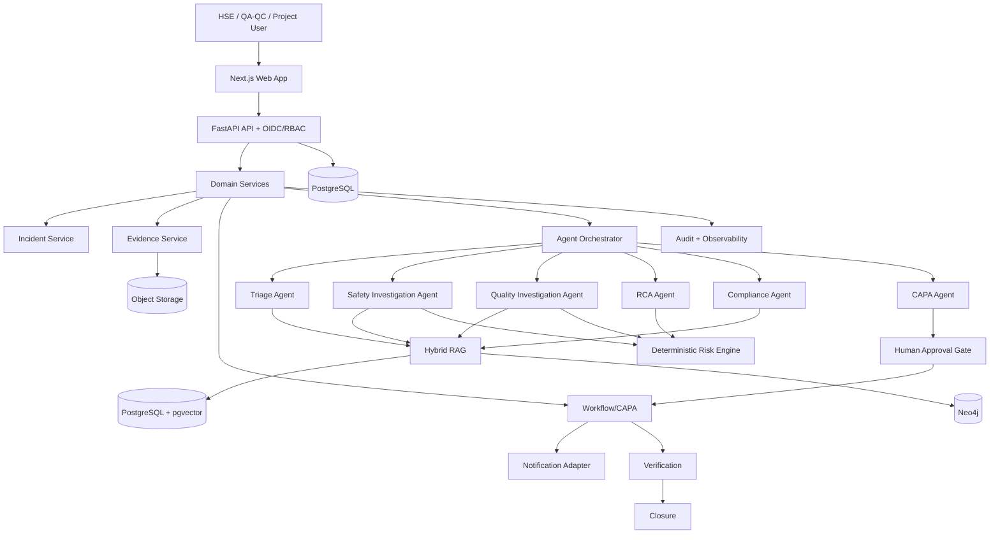

# Architecture

## Pattern

Modular backend + responsive web app + stateful agent orchestration. Keep components deployable in containers.

## Stack

Next.js; React; TypeScript; Tailwind; Python; FastAPI; Pydantic; SQLAlchemy; PostgreSQL; pgvector; Neo4j; object storage; Docker; GitHub Actions; Azure.





## Agent Components

Triage; Safety Investigation; Quality Investigation; RCA; Compliance; CAPA.

## Data Flow

Incident → evidence → retrieval → agents → risk/RCA/compliance → approval → workflow.

## Dependency Rules

UI does not access the database directly. Agents use approved service/tool interfaces. Provider-specific code stays behind adapters.

## What is built (0.2.0)

| Component | Where |
|---|---|
| Web app (Next.js, TypeScript, Tailwind; static export) | `frontend/`, served at `/app` |
| API, RBAC, tenant scoping | `backend/app/api`, `backend/app/core` |
| Agents, orchestrator, rules and Claude providers | `backend/app/agents` |
| Risk, lifecycle, CAPA, notifications/escalation, email outbox, reports (Markdown, Word, PDF), evidence, audit | `backend/app/services` |
| Knowledge graph (derived projection of PostgreSQL; in-memory or Neo4j store; off by default) | `backend/app/services/graph.py` |
| Vision evidence analysis (image decoding in an isolated child process, pluggable analyzer, engineer review) | `backend/app/services/vision.py`, `backend/app/agents/vision.py` |
| Document parsing (isolated child process), chunking, embeddings, hybrid retrieval, grounded answers | `backend/app/services/{parsing,chunking,embeddings,rag,answer}.py` |
| Migrations | `backend/migrations` (Alembic) |
| Evaluation and red-team | `backend/app/evaluation.py`, `data/eval/` |
| Dataset pipelines | `backend/app/datasets/`, `data/dataset_registry.yaml` |
| Scheduled jobs | `backend/app/jobs.py` |

Not built yet: graph-aware retrieval for agents, a trained vision detection model, OIDC; Azure is defined in Bicep but no environment exists yet (ROADMAP.md).

## Knowledge graph

PostgreSQL stays the system of record (DECISIONS 002). The graph is a derived projection: `build_projection` reads one
organization's records, and the store makes that organization's part of the graph equal to the result. Nothing is
written back to PostgreSQL and no model is called; every value is copied from a stored row.

```text
graph-sync (job or POST /graph/sync) ─ per organization: read PostgreSQL ─ projection (nodes + relationships)
  ─ store: MERGE every node on (label, id) and every relationship on its id ─ delete what the projection no longer has
GET /incidents/{id}/graph ─ authorize like reading the incident ─ incident-owned nodes + their direct neighbours
  ─ organization and caller's projects only ─ nodes and edges with provenance
```

`SITEGUARD_GRAPH_BACKEND` selects the store: `disabled` (default), `memory` (inside the API process, for tests and
single-process demos; a separate job process has its own copy) or `neo4j` (official driver; `docker compose
--profile graph up -d neo4j` starts one locally). Re-running a sync changes nothing. A record deleted in PostgreSQL
disappears from the graph, with its relationships, on the next sync of its organization; `graph-sync` also removes
organizations that no longer exist. Between syncs the graph can be behind PostgreSQL.

### Provenance

Every node and relationship carries `organization_id`, `project_id` (null for organization-level records) and:

| Field | Meaning |
|---|---|
| `source_table`, `source_id` | The PostgreSQL row it came from |
| `source_field` | The column or JSON path, when it came from one field (`location`, `output.hazards[2]`, `output.findings[0].source_ref`) |
| `ai_derived` | True when the content was taken from AI output (`agent_runs.output`, or an action the CAPA agent proposed) |
| `agent_run_id` | The `agent_runs` row for AI-derived items |
| `review_status` | `UNREVIEWED` for AI output no person has reviewed (hazards, causes, requirements, investigations); for actions `UNREVIEWED`, `HUMAN_APPROVED`, `HUMAN_MODIFIED`, `HUMAN_REJECTED` or `SUPERSEDED` from `capa_actions.approval_status` |

Nodes owned by an incident also carry `incident_id`. Relationship ids are deterministic
(`TYPE:start->end`, plus the source record id or cited ref where two records can link the same pair).

### Nodes

| Label | One node per | Notes |
|---|---|---|
| Organization | `organizations` row | |
| Project | `projects` row | |
| Site | `sites` row | |
| Location | incident with a `location` value | Asset/Location: there is no asset or location register, so this is the incident's free-text `location` (id `<incident>:location`, normalised `key` for grouping). Equipment named only in text is not extracted |
| Person | user named by the organization's records or memberships | Person/Role: id `<organization>:<user>`, so a user in two organizations is two nodes; roles are on `MEMBER_OF`; only the full name and active flag are copied (no email) |
| Incident | `incidents` row | Reference, title, status, severity, domain, dates, `is_synthetic` |
| Evidence | `evidence` row | File name, type, size, SHA-256 (no storage key) |
| Document | `documents` row | Title, type, version, status, domain, effective date, tags, SHA-256 |
| Investigation | `agent_runs` row of the triage, safety or quality agent | Run status and provider plus the output's scalar and list fields |
| Hazard | distinct hazard in a triage or safety output (`output.hazards[i]`) | Per run, so each keeps its exact source; group across incidents by `key` |
| RCA | `agent_runs` row of the RCA agent | Problem statement, whys, contributing factors |
| Cause | root cause in an RCA output (`output.root_causes[i]`) | Category, statement, confidence |
| Requirement | finding in a compliance output (`output.findings[i]`) | `status` is LIKELY_MET / LIKELY_NOT_MET / UNCLEAR: a possible gap for review, never a compliance determination |
| Action | `capa_actions` row | Type, owner role, due date, critical, approval and work status |

### Relationships

| Type | From → to | Source |
|---|---|---|
| BELONGS_TO | Project → Organization; Document → Organization (organization-wide documents) | `projects.organization_id`, `documents.organization_id` |
| PART_OF | Site → Project | `sites.project_id` |
| FOR_PROJECT | Document → Project | `documents.project_id` |
| MEMBER_OF | Person → Organization or Project (`role`, `scope`) | `memberships` row |
| IN_PROJECT, AT_SITE, AT_LOCATION, REPORTED_BY | Incident → Project, Site, Location, Person | `incidents.project_id`, `site_id`, `location`, `reporter_id` |
| HAS_EVIDENCE, UPLOADED_BY | Incident → Evidence; Evidence → Person | `evidence.incident_id`, `uploaded_by` |
| HAS_INVESTIGATION, HAS_RCA | Incident → Investigation, RCA | `agent_runs.incident_id` |
| IDENTIFIED_HAZARD, IDENTIFIED_CAUSE | Investigation → Hazard; RCA → Cause | the output field (AI) |
| HAS_REQUIREMENT, FROM_DOCUMENT | Incident → Requirement (`status`); Requirement → Document (`chunk_id`) | compliance `output.findings[i]` and its `source_ref` chunk (AI) |
| CITES | Investigation, RCA or Action → Evidence or Document (`ref`, `chunk_id`) | `output.evidence_refs` / `capa_actions.evidence_refs`; only this incident's evidence and documents its project can see |
| HAS_ACTION, ASSIGNED_TO | Incident → Action; Action → Person | `capa_actions.incident_id`, `assignee_id` |
| ADDRESSES | Action → Hazard or Cause of the same AI workflow | `original_ai_output.addresses` when it names that hazard or cause word for word (AI) |
| REVIEWED_BY | Action → Person (`decision`, `reason`) | `approval_events` row |
| VERIFIED_BY, VERIFIED_WITH | Action → Person (`effective`); Action → Evidence | `verification_records` row and its `evidence_id` |

### Isolation

Node ids are relational ids (people are scoped per organization), every relationship joins two nodes of the same
organization, and the store refuses a projection that would take over another organization's node. The Neo4j adapter
sends only fixed Cypher built from the label and type allowlists above, with all data as parameters, and gives every
node the extra label `SgEntity` (indexed on `organization_id` and `incident_id`). The neighbourhood query filters by
organization and the caller's projects in Cypher, and the service filters the result again.
