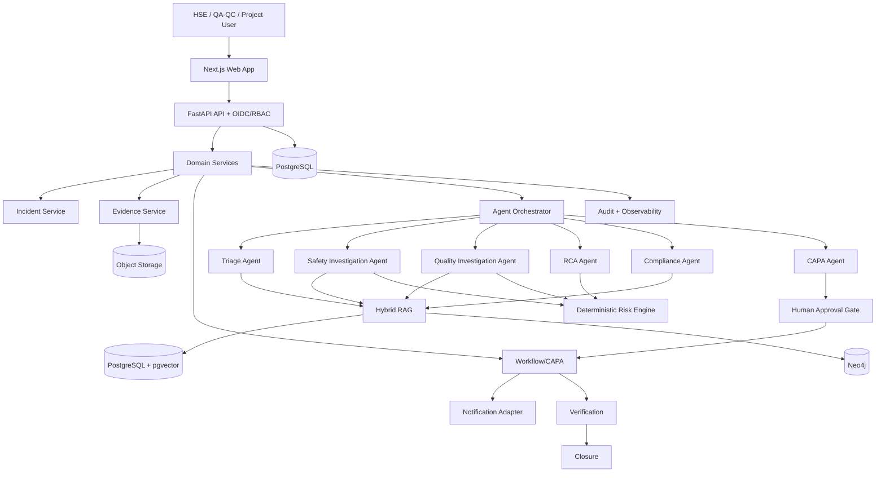

# Architecture

## Pattern

Modular backend + responsive web app + stateful agent orchestration. Keep components deployable in containers.

## Stack

Next.js; React; TypeScript; Tailwind; Python; FastAPI; Pydantic; SQLAlchemy; PostgreSQL; pgvector; Neo4j; object storage; Docker; GitHub Actions; Azure.

## Agent Components

Triage; Safety Investigation; Quality Investigation; RCA; Compliance; CAPA.

## Data Flow

Incident → evidence → retrieval → agents → risk/RCA/compliance → approval → workflow.

## Dependency Rules

UI does not access the database directly. Agents use approved service/tool interfaces. Provider-specific code stays behind adapters.

## What is built (0.2.0)

| Component | Where |
|---|---|
| Web app (Next.js, TypeScript, Tailwind; static export) | `frontend/`, served at `/app` |
| API, RBAC, tenant scoping | `backend/app/api`, `backend/app/core` |
| Agents, orchestrator, rules and Claude providers | `backend/app/agents` |
| Risk, lifecycle, CAPA, notifications/escalation, reports, RAG (BM25), evidence, audit | `backend/app/services` |
| Migrations | `backend/migrations` (Alembic) |
| Evaluation and red-team | `backend/app/evaluation.py`, `data/eval/` |
| Dataset pipelines | `backend/app/datasets/`, `data/dataset_registry.yaml` |
| Scheduled jobs | `backend/app/jobs.py` |

Not built yet: pgvector/hybrid retrieval, Neo4j, vision, OIDC, Azure resources (ROADMAP.md).
