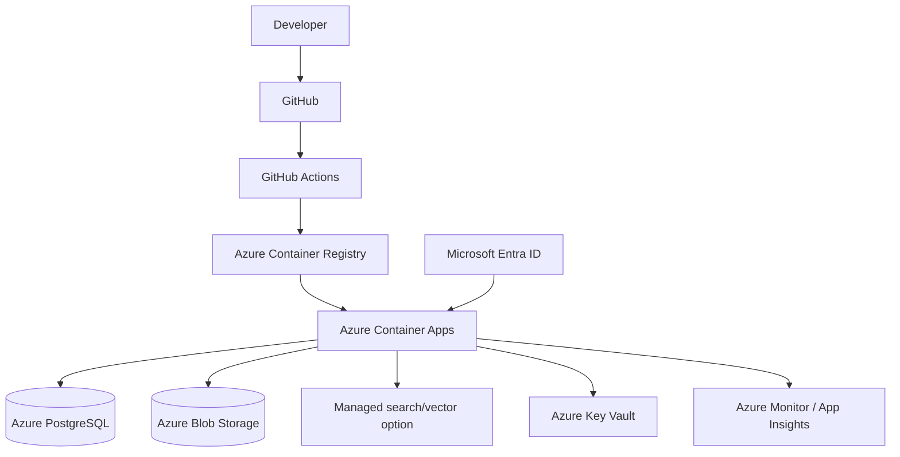

# Deployment

## Target

Docker + GitHub Actions + Azure Container Registry + Azure Container Apps + managed PostgreSQL + Blob Storage + Key Vault + Monitor.





## Flow

Test → Build → Scan → Push → Staging → Migrate → Smoke test → Approval → Production.

## Rollback

Use versioned container image and database migration strategy. Never perform destructive rollback blindly.

## What exists today

- `backend/Dockerfile`: two stages. Node builds the web app; the Python image installs the locked dependencies
  (`backend/requirements.lock`), serves the API and the web app at `/app`, runs `alembic upgrade head` on start, runs
  as a non-root user (uid 10001) and has a health check. Seed data is baked in; seeding is on only when
  `SITEGUARD_ENV` is local, test or demo.
- `docker-compose.yml`: local PostgreSQL 16 (pgvector image) + API.
- `deployment/staging/`: isolated single-host staging stack ([Staging](#staging)).
- `deployment/azure/`: Bicep for one Azure environment per resource group ([Azure](#azure)), deployed by the manual
  `.github/workflows/deploy.yml` workflow.
- `scripts/smoke_test.py`, `scripts/backup.py`, `scripts/dependency_audit.py`: operations ([Smoke test](#smoke-test),
  [Backup and restore](#backup-and-restore)).
- Scheduled jobs: `python -m app.jobs escalate-overdue deliver-notifications` (both idempotent), from cron or the
  Azure Container Apps job.
- CI (`.github/workflows/ci.yml`): backend lint, types and tests; PostgreSQL migrations and restore drill; dependency
  audit (also weekly); Bicep, actionlint and compose checks; web typecheck and build; image build, smoke test,
  browser tests and a full resolution run against the container.

## Smoke test

```bash
SITEGUARD_SMOKE_EMAIL=<read-only account> SITEGUARD_SMOKE_PASSWORD=<password> \
  python scripts/smoke_test.py --api-url https://<host> --web-url https://<host> --wait 300 --require-login
```

Checks `/health` (and its security headers), that anonymous reads and unknown users are refused, sign-in and an
authenticated read with the given account, the redirect to `/app/`, the web app with its Content-Security-Policy, the
login page, and HSTS on https. Credentials come from the environment, never the command line; use an AUDITOR or
VIEWER account. Without credentials the signed-in checks are skipped (failed with `--require-login`).

## Staging

`deployment/staging/docker-compose.staging.yml` runs the same image on one host as an isolated stack: its own project
name, PostgreSQL database and volume, evidence volume and secrets. `SITEGUARD_ENV=staging`, demo seeding off and the
database URL are fixed in the compose file; only the listed settings reach the containers. Ports bind to loopback;
put a TLS reverse proxy in front of the API port (it also serves `/app`).

```bash
sudo install -d -m 700 /etc/siteguard
sudo cp deployment/staging/staging.env.example /etc/siteguard/staging.env && sudo chmod 600 /etc/siteguard/staging.env
# Replace every CHANGE value: random database password and JWT secret
# (python -c "import secrets; print(secrets.token_urlsafe(48))"), the https staging URL ending in /app.
docker compose -f deployment/staging/docker-compose.staging.yml --env-file /etc/siteguard/staging.env up -d --build --wait
python scripts/smoke_test.py --api-url http://127.0.0.1:8000 --web-url http://127.0.0.1:8000
# Scheduled job from cron, for example hourly:
docker compose -f deployment/staging/docker-compose.staging.yml --env-file /etc/siteguard/staging.env run --rm jobs
```

The API refuses to start while a `CHANGE` value, an http URL or a weak secret is left. Staging starts empty: there is
no user-provisioning path yet without demo seeding ([Known gaps](#known-gaps)).

**Upgrade (backup before migrate).** The image migrates on start, so every upgrade starts with a backup:

```bash
STAGING=(docker compose -f deployment/staging/docker-compose.staging.yml --env-file /etc/siteguard/staging.env)
EVIDENCE=$(docker volume inspect siteguard-staging_staging-evidence -f '{{.Mountpoint}}')   # root-readable
export SITEGUARD_DATABASE_URL='postgresql://siteguard:<db password>@127.0.0.1:5433/siteguard_staging'
STAMP=$(date -u +%Y%m%dT%H%M%SZ)
python3 scripts/backup.py backup --evidence-dir "$EVIDENCE" --out /var/backups/siteguard/$STAMP
docker inspect -f '{{.Config.Image}}' siteguard-staging-api-1          # record the running image
git pull && "${STAGING[@]}" up -d --build --wait                     # or set SITEGUARD_API_IMAGE to a CI-built tag
python scripts/smoke_test.py --api-url http://127.0.0.1:8000 --web-url http://127.0.0.1:8000
python3 scripts/backup.py verify --evidence-dir "$EVIDENCE" --manifest /var/backups/siteguard/$STAMP/manifest.json
```

**Roll back.** If the schema is unchanged, run the previous image again. If a migration ran, restore the backup taken
before it into a fresh database (the failed one is renamed and kept, never overwritten):

```bash
"${STAGING[@]}" stop api
"${STAGING[@]}" exec -T db psql -U siteguard -d postgres -v ON_ERROR_STOP=1 \
  -c "ALTER DATABASE siteguard_staging RENAME TO siteguard_staging_before_rollback_$(echo $STAMP | tr A-Z a-z)" \
  -c "CREATE DATABASE siteguard_staging"
export SITEGUARD_RESTORE_DATABASE_URL="$SITEGUARD_DATABASE_URL"
python3 scripts/backup.py restore --backup /var/backups/siteguard/$STAMP --evidence-dir /var/tmp/siteguard-restore-$STAMP
SITEGUARD_API_IMAGE=<previous image> "${STAGING[@]}" up -d --no-build --wait
```

## Backup and restore

`scripts/backup.py` backs up the database and the evidence directory together, with checksums:

```bash
export SITEGUARD_DATABASE_URL='postgresql+psycopg://...'            # from the environment, never the command line
python scripts/backup.py backup --evidence-dir /srv/evidence --out /backups/$(date -u +%Y%m%dT%H%MZ)
export SITEGUARD_RESTORE_DATABASE_URL='postgresql+psycopg://.../siteguard_restore'   # an EMPTY database
python scripts/backup.py restore --backup /backups/<stamp> --evidence-dir /srv/evidence-restored
python scripts/backup.py verify --evidence-dir /srv/evidence [--manifest /backups/<stamp>/manifest.json]
```

- A backup holds `database.dump` (pg_dump custom format), `evidence.tar.gz` and `manifest.json` (SHA-256 of both,
  per-file evidence hashes, row counts, Alembic revision), written 0700/0600. It contains personal data
  (GOVERNANCE.md).
- `restore` checks every checksum first, refuses a non-empty database or evidence directory, restores in one
  transaction, extracts only files listed in the manifest, then verifies. `verify` checks every evidence row's file
  against the SHA-256 stored in the database.
- **Drill:** `backend/tests/test_backup_restore.py` seeds data and evidence through the application, backs up,
  restores into a fresh database and directory, and checks row counts, evidence hashes, search on the copy, refusal
  to restore over data and detection of a tampered file. CI runs it in the `postgres` job.

## Azure

`deployment/azure/main.bicep` (modules in `deployment/azure/modules/`, ported from PR #2) builds one environment
(staging or production) per resource group:

| Resource | Configuration |
|---|---|
| Virtual network | Container Apps subnet (Microsoft.Storage service endpoint) and a delegated PostgreSQL subnet |
| PostgreSQL Flexible Server 16 | Private access only, TLS required, `azure.extensions=VECTOR` allow-listed, automated backups (7–35 days, optional geo-redundancy), optional zone-redundant HA |
| Storage account | `evidence` Azure Files share mounted at `/srv/evidence` (uid/gid 10001); HTTPS only, TLS 1.2, no public blob access, firewall admits only the apps subnet, share soft delete |
| Key Vault | RBAC mode, soft delete and purge protection; secrets `database-url`, `jwt-secret`, optional `anthropic-api-key` and `smtp-password` |
| Managed identity | One user-assigned identity: AcrPull on the registry, Key Vault Secrets User on the vault. No registry passwords or secret values in app configuration |
| Container Registry | Basic, admin user disabled |
| Container Apps environment | In the VNet, logs to Log Analytics |
| App (`<prefix>-api`) | API + web app in one container, external HTTPS-only ingress, one replica (in-process login throttle), startup and liveness probes on `/health`, readiness probe on `/ready` (database answers, schema at the latest migration) |
| Scheduled job | `python -m app.jobs escalate-overdue deliver-notifications` on `jobsCron` (default hourly); email settings from `emailAdapter`, `smtpHost`, `smtpPort`, `smtpUsername`, `smtpFrom` |
| Migration job | Manual trigger, no retries, `alembic upgrade head`; the deploy workflow runs it with the new image before the rollout |
| Log Analytics, Application Insights | Container logs; availability test of `/health` from three regions with TLS certificate checks |

The deployment is in two phases because the app needs an image that exists in the registry first.

### Owner steps (first deployment)

Nothing here has been run against a real subscription. Each step needs the owner (Azure Owner or User Access
Administrator on the resource group, since the templates create role assignments).

1. Choose region, names and sizing; create one resource group per environment
   (`az group create -n rg-siteguard-staging -l <region>`). Run `az deployment group what-if` first.
2. **Deploy identity (OIDC, no stored secrets):** a Microsoft Entra app registration and service principal for
   GitHub Actions with a federated credential per environment: issuer `https://token.actions.githubusercontent.com`,
   subject `repo:sricharansk/SITEGUARD-AI:environment:staging` (and `...:production`), audience
   `api://AzureADTokenExchange`. Its object ID is `deployPrincipalId`.
3. **GitHub environments** `staging` and `production`: required reviewers; production limited to `main`. Variables
   `AZURE_CLIENT_ID`, `AZURE_TENANT_ID`, `AZURE_SUBSCRIPTION_ID`, `AZURE_RESOURCE_GROUP`, optional
   `SITEGUARD_PUBLIC_ORIGIN`; optional secrets `SMOKE_TEST_EMAIL`, `SMOKE_TEST_PASSWORD`.
4. **Phase 1, infrastructure:** copy `main.example.bicepparam`, set `deployPrincipalId`, keep `deployApps = false`:
   ```bash
   umask 077; python3 -c "import secrets; print(secrets.token_urlsafe(36))" > pg-admin.txt   # into a password manager
   SITEGUARD_POSTGRES_ADMIN_PASSWORD="$(cat pg-admin.txt)" \
     az deployment group create -g rg-siteguard-staging -f deployment/azure/main.bicep -p staging.bicepparam
   ```
5. **Secrets** (from files, so they never appear in shell history):
   ```bash
   python3 -c "import secrets; print(secrets.token_urlsafe(48), end='')" > jwt.txt
   az keyvault secret set --vault-name <keyVaultName output> --name jwt-secret --file jwt.txt
   shred -u jwt.txt pg-admin.txt
   ```
   With `emailAdapter = 'smtp'`, also store the SMTP password as `smtp-password` the same way.
6. **Image:** run the **Deploy** workflow for `staging` with `push_only`; its summary lists the image digest.
7. **Phase 2:** set `deployApps = true` and `apiImage` to that digest; deploy again.
8. **Release:** run Deploy without `push_only`. It checks that CI passed for the commit, pushes the image, records the
   rollback point, runs the migration job, updates the app and the scheduled job, and runs the smoke test.
9. **Harden before real data:** a dedicated database role for the app (store its URL as `database-url`, set
   `writeDatabaseUrlSecret = false`); custom domain and managed certificate (`publicWebUrl`); Key Vault private
   endpoint if required; production sizing (GeneralPurpose, HA, longer retention, geo backups, alerts).

### Azure rollback

- **Release failed, schema unchanged:** the workflow summary prints the previous image and the
  `az containerapp update ... --image <previous>` commands. A failed migration stops the workflow before the app is
  touched.
- **A migration must be undone:** restore PostgreSQL to the recorded rollback point as a **new** server
  (`az postgres flexible-server restore ... --restore-time <rollback point>`), check it, point `database-url` at it,
  restart the app and roll back the image. Export newer audit events first. Never downgrade a schema in place, and
  never delete the original server, without the owner's approval.

### Offline validation

```bash
az bicep build --file deployment/azure/main.bicep
for f in deployment/azure/main.bicep deployment/azure/modules/*.bicep; do az bicep lint --file "$f"; done
SITEGUARD_POSTGRES_ADMIN_PASSWORD=dummy-for-validation az bicep build-params --file deployment/azure/main.example.bicepparam
```

CI runs these, `actionlint` (with shellcheck) and the staging compose check in the `infrastructure` job.

## Knowledge graph

Optional; keep `SITEGUARD_GRAPH_BACKEND=disabled` until a Neo4j host is chosen (an owner decision; the Azure templates
do not create one). When it is enabled: use `bolt+s://` or `neo4j+s://` (the API refuses plain Bolt in staging and
production), keep `SITEGUARD_NEO4J_PASSWORD` in Key Vault, and schedule `python -m app.jobs graph-sync` after the other
jobs. The graph holds no data that PostgreSQL does not, so it needs no backup of its own: rebuild it with `graph-sync`.

## Known gaps

- **Evidence storage** is a file path, so Azure uses an Azure Files (SMB) share; a Blob Storage adapter, retention and
  malware scanning are open. Confirm the SMB mount works with the storage firewall in the first deployment.
- **No user provisioning without demo seeding:** a new staging or production environment has no accounts until an
  admin bootstrap command, invitations or SSO exist. Until then the smoke test runs its anonymous checks.
- **Single replica:** the login throttle is in-process; scale out only after a shared store exists. One process
  serves about 55 requests per second; measured capacity and what to change before scaling are in
  [LOAD_TEST.md](LOAD_TEST.md).
- **Migrations also run on container start;** the migration job runs them first so a failure stops the rollout.
- **No telemetry SDK:** Application Insights holds availability results; logs go to Log Analytics.
- **Anthropic provider** sends incident content to an external API; it stays off (`rules`) unless the owner approves.
- **Email** sends notification text (incident references and action titles) through the configured SMTP provider; it
  stays `disabled` unless the owner approves. There is no per-user email opt-out yet.
