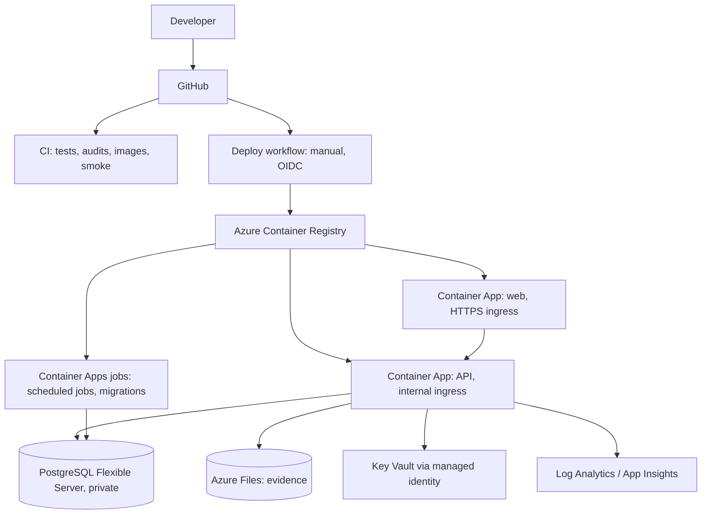

# Deployment

Production deployment needs the project owner's explicit approval (open decision O12 in `docs/DECISIONS.md`).
Everything below is code and procedure; nothing has been deployed to a cloud environment.

## Target

Docker images, GitHub Actions, Azure Container Registry, Azure Container Apps, Azure Database for PostgreSQL
Flexible Server (pgvector), Azure Files for evidence (Blob Storage once open decision O6 is settled), Key Vault,
Log Analytics and Application Insights.



## Flow

CI (lint, types, tests, PostgreSQL + restore drill, dependency audit, images, compose and staging smoke tests,
Bicep and workflow checks) → manual deploy to staging → migrate → smoke test → owner approval → the same commit to
production → migrate → smoke test.

## Images

| Image | Dockerfile | Base | Runs as | Health check |
|---|---|---|---|---|
| API | `backend/Dockerfile` (context: repository root, `backend/Dockerfile.dockerignore`) | Python 3.12 slim, pinned by digest | uid 10001, only `/srv/evidence` writable | `GET /health` |
| Web | `frontend/Dockerfile` (context: `frontend/`) | Node 22 Alpine, pinned by digest; npm, npx, yarn and corepack removed | uid 10001, only `.next/cache` writable | `GET /api/health` |

- Multi-stage builds; configuration only from the environment; no secrets in any layer (the build contexts are
  allowlists, `.env*` never enters them).
- The API image sets `SITEGUARD_ENV=production`, so a container started without configuration refuses to run
  (docs/GOVERNANCE.md#configuration-validation). Local stacks set `local` or `demo` explicitly.
- Behind a TLS-inspecting proxy, pass its CA as a build secret (never stored in a layer):
  `docker build --secret id=build_ca,src=/path/to/ca.pem ...`.
- **Bumping a base image:** change the tag and the digest together in the `ARG` line
  (`docker buildx imagetools inspect python:3.12-slim` prints the current digest), build, run CI.

```bash
docker build -f backend/Dockerfile -t siteguard-api:local .
docker build -t siteguard-web:local frontend
cp .env.example .env    # set SITEGUARD_ENV=local or demo and change every CHANGE value
docker compose up -d --wait
python scripts/smoke_test.py --api-url http://127.0.0.1:8000 --web-url http://localhost:3000
```

## Smoke test

`scripts/smoke_test.py` checks API health and security headers, that anonymous and unknown-user requests are refused,
sign-in and an authenticated read (`/me`, `/projects`), then the web app: `/api/health` reports the API reachable, CSP
and frame headers, signed-out redirect, cross-site sign-in refused (CSRF), BFF refuses anonymous reads, httpOnly
session cookie, a read through the BFF and sign-out. Credentials come from `SITEGUARD_SMOKE_EMAIL` and
`SITEGUARD_SMOKE_PASSWORD` (use an AUDITOR or VIEWER account); without them the signed-in checks are skipped unless
`--require-login` is given. `--wait 300` waits for the health endpoints first.

## Staging

`deployment/staging/docker-compose.staging.yml` runs the same images on one host as an isolated stack: its own
project name, PostgreSQL database and volume, evidence volume and secrets. `SITEGUARD_ENV=staging`, demo seeding
off and the database URL are fixed in the compose file; external notifications default to `disabled` and the AI
provider to `rules`. Only the listed settings reach the containers. Ports bind to loopback; put a TLS reverse proxy
in front of the web port (the session cookie is Secure).

### First start

```bash
sudo install -d -m 700 /etc/siteguard
sudo cp deployment/staging/staging.env.example /etc/siteguard/staging.env && sudo chmod 600 /etc/siteguard/staging.env
# Replace every CHANGE value: random database password and JWT secret
# (python -c "import secrets; print(secrets.token_urlsafe(48))"), the https staging URL.
docker compose -f deployment/staging/docker-compose.staging.yml --env-file /etc/siteguard/staging.env \
  up -d --build --wait
python scripts/smoke_test.py --api-url http://127.0.0.1:8000 --web-url http://127.0.0.1:3000
# Scheduled jobs from cron, for example every 15 minutes:
docker compose -f deployment/staging/docker-compose.staging.yml --env-file /etc/siteguard/staging.env run --rm jobs
```

The API refuses to start while a `CHANGE` value, an http URL or a weak secret is left. Staging starts empty: there
is no user-provisioning path yet without demo seeding (see [Gaps](#known-gaps)), so the smoke test runs its
anonymous checks until an account exists.

### Upgrade: backup before migrate

The API applies Alembic migrations on startup (Decision 011), so every upgrade starts with a backup.

```bash
STAGING=(docker compose -f deployment/staging/docker-compose.staging.yml --env-file /etc/siteguard/staging.env)
EVIDENCE=$(docker volume inspect siteguard-staging_staging-evidence -f '{{.Mountpoint}}')   # root-readable
export SITEGUARD_DATABASE_URL='postgresql://siteguard:<db password>@127.0.0.1:5433/siteguard_staging'
STAMP=$(date -u +%Y%m%dT%H%M%SZ)
# 1. Back up (PostgreSQL 16 client tools on the host; the backup is written 0700/0600)
python3 scripts/backup.py backup --evidence-dir "$EVIDENCE" --out /var/backups/siteguard/$STAMP
# 2. Record the running images, then roll out the new ones (migrations run when the API starts)
docker inspect -f '{{.Config.Image}}' siteguard-staging-api-1 siteguard-staging-web-1
git pull && "${STAGING[@]}" up -d --build --wait      # or set SITEGUARD_API_IMAGE / SITEGUARD_WEB_IMAGE to CI-built tags
# 3. Smoke test and check evidence against the database
python scripts/smoke_test.py --api-url http://127.0.0.1:8000 --web-url http://127.0.0.1:3000
python3 scripts/backup.py verify --evidence-dir "$EVIDENCE" --manifest /var/backups/siteguard/$STAMP/manifest.json
```

`verify` with `--manifest` reports row-count differences from the backup; after a migration that is expected only for
tables the migration changed.

### Roll back

If the new release fails and the schema is unchanged, run the previous images again (step 2's recorded tags). If a
migration ran, restore the backup taken before it. Nothing is overwritten: the failed database is renamed and kept.

```bash
"${STAGING[@]}" stop web api
"${STAGING[@]}" exec -T db psql -U siteguard -d postgres -v ON_ERROR_STOP=1 \
  -c "ALTER DATABASE siteguard_staging RENAME TO siteguard_staging_before_rollback_$(echo $STAMP | tr A-Z a-z)" \
  -c "CREATE DATABASE siteguard_staging"
export SITEGUARD_RESTORE_DATABASE_URL="$SITEGUARD_DATABASE_URL"
# Restores the database in one transaction; the evidence copy goes to a check directory (the live volume already
# holds every file, since evidence is never modified or deleted).
python3 scripts/backup.py restore --backup /var/backups/siteguard/$STAMP --evidence-dir /var/tmp/siteguard-restore-$STAMP
python3 scripts/backup.py verify --evidence-dir "$EVIDENCE" --manifest /var/backups/siteguard/$STAMP/manifest.json
SITEGUARD_API_IMAGE=<previous api image> SITEGUARD_WEB_IMAGE=<previous web image> "${STAGING[@]}" up -d --no-build --wait
python scripts/smoke_test.py --api-url http://127.0.0.1:8000 --web-url http://127.0.0.1:3000
```

Data written after the backup is in the renamed database; recover what is needed from it, then drop it only with the
owner's approval. Both procedures were rehearsed on a local staging stack (backup, rollout, smoke, verify; and
backup, later change, rename, restore, verify, smoke).

## Azure

`deployment/azure/main.bicep` (modules under `deployment/azure/modules/`) builds one environment (staging or
production) per resource group:

| Resource | Configuration |
|---|---|
| Virtual network | Container Apps subnet (Microsoft.Storage service endpoint) and a delegated PostgreSQL subnet |
| PostgreSQL Flexible Server 16 | Private access only (no public endpoint), TLS required, `azure.extensions=VECTOR` allow-listed for pgvector, automated backups (7–35 days, optional geo-redundancy), optional zone-redundant HA |
| Storage account | `evidence` Azure Files share mounted at `/srv/evidence` (uid/gid 10001); HTTPS only, TLS 1.2, no public blob access, firewall admits only the apps subnet, share soft delete |
| Key Vault | RBAC mode, soft delete and purge protection; secrets `database-url`, `jwt-secret`, optional `anthropic-api-key` |
| Managed identity | One user-assigned identity for the apps: AcrPull on the registry, Key Vault Secrets User on the vault. No registry passwords or secret values in app configuration |
| Container Registry | Basic, admin user disabled |
| Container Apps environment | In the VNet, logs to Log Analytics |
| API app | Internal ingress (only the web app reaches it), HTTPS only, one replica (the login limiter is in-process, O10), startup/liveness/readiness probes on `/health` |
| Web app | External HTTPS-only ingress (HTTP is redirected), probes on `/api/health`, 1–`webMaxReplicas` replicas |
| Scheduled job | `python -m app.jobs all` on `jobsCron` (default every 5 minutes) |
| Migration job | Manual trigger, no retries; the deploy workflow runs it with the new image before the rollout |
| Log Analytics, Application Insights | Container logs; availability test of `<web>/api/health` requiring `"api":"ok"` from three regions, with TLS certificate checks |

The deployment is in two phases because the apps need images that exist in the registry first.

### Owner steps (first deployment)

Nothing here has been run. Each step needs the owner (Azure Owner or User Access Administrator on the resource
group, since the templates create role assignments).

1. **Approve** the environment (O12) and choose region, names and sizing. Create one resource group per
   environment: `az group create -n rg-siteguard-staging -l <region>`.
2. **Deploy identity (OIDC, no stored secrets):** create a Microsoft Entra app registration and service principal
   for GitHub Actions, with a federated credential per environment:
   issuer `https://token.actions.githubusercontent.com`, subject
   `repo:sricharansk/SITEGUARD-AI:environment:staging` (and `...:environment:production`), audience
   `api://AzureADTokenExchange`. Note the service principal's object ID for `deployPrincipalId`. The templates grant
   it only AcrPush on the registry, Reader on the resource group, Contributor on the two apps and two jobs, and
   Managed Identity Operator on the apps' identity.
3. **GitHub environments** `staging` and `production` (Settings > Environments): required reviewers (the owner);
   production limited to the `main` branch. Environment variables: `AZURE_CLIENT_ID`, `AZURE_TENANT_ID`,
   `AZURE_SUBSCRIPTION_ID`, `AZURE_RESOURCE_GROUP`, optional `SITEGUARD_PUBLIC_WEB_URL`. Optional environment
   secrets: `SMOKE_TEST_EMAIL`, `SMOKE_TEST_PASSWORD` (a read-only account, once accounts exist).
4. **Phase 1, infrastructure:** copy `deployment/azure/main.example.bicepparam` to `staging.bicepparam` (keep it
   out of git if it names anything sensitive), set `deployPrincipalId`, leave `deployApps = false`, then:
   ```bash
   umask 077; python3 -c "import secrets; print(secrets.token_urlsafe(36))" > pg-admin.txt   # into a password manager
   SITEGUARD_POSTGRES_ADMIN_PASSWORD="$(cat pg-admin.txt)" \
     az deployment group create -g rg-siteguard-staging -f deployment/azure/main.bicep -p staging.bicepparam
   ```
   With `writeDatabaseUrlSecret = true` the template writes `database-url` to Key Vault.
5. **Secrets:** give yourself Key Vault Secrets Officer on the vault, then write secrets from files so they never
   appear in shell history or process lists, and delete the files:
   ```bash
   python3 -c "import secrets; print(secrets.token_urlsafe(48), end='')" > jwt.txt
   az keyvault secret set --vault-name <keyVaultName output> --name jwt-secret --file jwt.txt
   # only with aiProvider = 'anthropic':
   az keyvault secret set --vault-name <keyVaultName> --name anthropic-api-key --file anthropic.txt
   shred -u jwt.txt anthropic.txt pg-admin.txt
   ```
6. **Images:** run the **Deploy** workflow for `staging` with `push_only` checked. Its summary lists the image
   references (by digest).
7. **Phase 2, apps:** set `deployApps = true`, `apiImage` and `webImage` to those references and deploy again (same
   command). The API applies migrations on its first start.
8. **Release:** from now on, run the Deploy workflow without `push_only`. It checks that CI passed for the commit,
   pushes images, records the rollback point, runs the migration job, updates the API, web app and scheduled job,
   and runs the smoke test against the web URL.
9. **Harden** before real data:
   - Create a dedicated application database role with only the privileges the app needs, store its URL as
     `database-url`, and set `writeDatabaseUrlSecret = false` so later deployments keep it; keep the admin login for
     migrations and break-glass use (docs/GOVERNANCE.md#audit-retention).
   - Custom domain and managed certificate for the web app; set `publicWebUrl`.
   - Restrict Key Vault networking (private endpoint) if the organization requires it.
   - Production sizing: GeneralPurpose SKU, `postgresHighAvailability`, longer backup retention, geo-redundant
     backups, longer log retention; alerts on the availability test.
10. **Production:** repeat steps 1–8 for `production` from `main`, after staging has passed.

### Azure rollback

- **Release failed, schema unchanged:** the workflow summary prints the previous image references and the
  `az containerapp update ... --image <previous>` commands. A failed migration stops the workflow before the API is
  touched.
- **A migration must be undone:** restore PostgreSQL to the recorded rollback point as a **new** server
  (`az postgres flexible-server restore -g <rg> --source-server <server> --name <new server>
  --restore-time <rollback point>`), check it, point the `database-url` secret at it, restart the API revision and
  roll back the images. Export audit events written after the rollback point first. Never downgrade a schema in
  place, and never delete the original server, without the owner's approval.
- **Evidence:** files are never modified or deleted by the application; the share has soft delete for accidental
  deletion of the share itself. `scripts/backup.py` can take logical backups from a host with access.

### Offline validation

```bash
az bicep build --file deployment/azure/main.bicep
az bicep lint --file deployment/azure/main.bicep
SITEGUARD_POSTGRES_ADMIN_PASSWORD=dummy az bicep build-params --file deployment/azure/main.example.bicepparam
```

CI runs these and `actionlint` in the `infrastructure` job. A `what-if` against a real subscription
(`az deployment group what-if ...`) is the owner's first step before phase 1.

## Known gaps

- **Evidence storage:** the API writes evidence to a file path, so Azure uses an Azure Files (SMB) share. A Blob
  Storage adapter, retention and malware scanning are open decision O6. The storage firewall admits only the apps
  subnet; confirm the SMB mount works with that rule in the first deployment (set `restrictStorageToSubnet = false`
  temporarily if it does not, and record why).
- **No user provisioning without demo seeding:** there is no admin bootstrap command, invitation flow or SSO yet
  (O1, O2), so a new staging or production environment has no accounts. A supported bootstrap command is the next
  step before go-live; until then the smoke test runs its anonymous checks.
- **Single API replica:** the login rate limiter is in-process (O10); scale out only after a shared store exists.
- **Migrations also run on API startup** (Decision 011). The migration job runs them first so a failure stops the
  rollout; the startup run is then a no-op.
- **API inside the environment** is reached over the Container Apps internal HTTPS endpoint; the API itself does not
  terminate TLS.
- **No telemetry SDK:** Application Insights holds availability results; application logs go to Log Analytics
  (docs/OBSERVABILITY.md).
- **Anthropic provider** sends incident content to an external API; it stays off (`rules`) unless the owner
  approves it (docs/GOVERNANCE.md#model-and-provider-governance).
