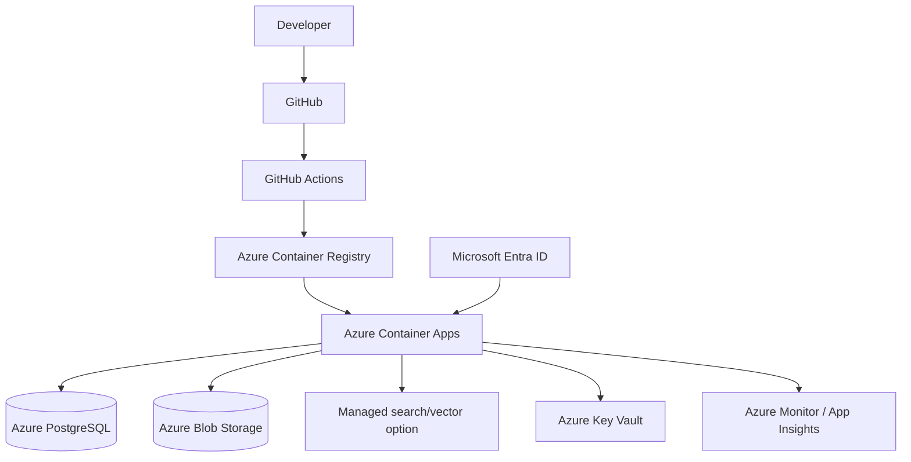

# Deployment

## Target

Docker + GitHub Actions + Azure Container Registry + Azure Container Apps + managed PostgreSQL + Blob Storage + Key Vault + Monitor.

## Flow

Test → Build → Scan → Push → Staging → Migrate → Smoke test → Approval → Production.

## Rollback

Use versioned container image and database migration strategy. Never perform destructive rollback blindly.

## What exists today (0.2.0)

- `backend/Dockerfile`: two stages. Node builds the web app; the Python image serves the API and the web app at
  `/app`, runs `alembic upgrade head` on start, runs as a non-root user and has a health check. Seed data is baked in
  (disable with `SITEGUARD_SEED_DEMO_DATA=false`).
- Daily job for overdue actions: `python -m app.jobs escalate-overdue` (Azure Container Apps job or cron) using the
  same image.
- `docker-compose.yml`: PostgreSQL 16 with pgvector + API, verified locally with the walkthrough script.
- `.github/workflows/ci.yml`: backend lint/types/tests, frontend typecheck/build/audit, image build, browser tests
  and a full resolution run against the container.

## Azure pilot steps (next milestone)

1. Create Azure Container Registry, a Container Apps environment, Azure Database for PostgreSQL Flexible Server,
   a Storage account and Key Vault.
2. Push the image from CI to ACR on `main`.
3. Container App settings: `SITEGUARD_DATABASE_URL`, `SITEGUARD_JWT_SECRET` and `ANTHROPIC_API_KEY` from Key
   Vault; `SITEGUARD_ENV=staging`; `SITEGUARD_SEED_DEMO_DATA=true` only for the demo environment.
4. Mount Azure Files (or switch the evidence adapter to Blob Storage) at `SITEGUARD_EVIDENCE_DIR`.
5. Smoke test `/health`, then run `scripts/demo_walkthrough.py --base-url <staging-url>`.
